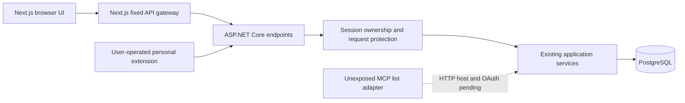

# MyShoppingList implementation audit

Audit date: 31 October 2026 (Australia/Adelaide).

Status: Phases 0–4 verified locally; Phase 5 test-only groundwork verified; Phase 6 design record delivered, optional sharing/execution gate closed. Full commercial/sandbox-provider and launch prerequisites remain open. New integrations default off. Historical evidence below is dated by increment. This report describes inspected code and observed command results, not a production deployment or a claim of verified live behaviour.

Latest follow-up: [release readiness](RELEASE_READINESS.md) records the complete API/browser runs and their exact limitations. Production-build browser regression: **473 passed, zero failures/flaky results, 3 intentional skips**, desktop/mobile, 9.7m. Full API relational run: **3,041 passed, 18 failed, 5 skipped**, 21m34s; the command incorrectly forced feature flags off. Corrected feature rerun **30 passed**, and report-name comparison covers **all 18 failed cases**. Rebuilt available API suite: **2,682 passed, 383 skips, zero failures**. Controlled no-external-network browser groups: **4 passed**. The full run loaded the build before the added timeout case; the final feature/available runs cover it. This supersedes earlier statements that no full relational rerun had occurred, without rewriting historical results as passing.

The follow-up fixed durable provider-timeout retry handling (genuine cancellation still propagates; **13 billing cases passed**) and excluded private local configuration from API publish output, verified with actual local Debug/Release artifacts. Repaired stale ALDI-copy and refresh-completion timing assertions; a development session-restoration timeout did not recur in the complete production run. TypeScript/lint/build/whitespace checks pass, with two existing refresh-fixture lint warnings. All owned test services stopped; temporary password/private-config copies removed; 3001/5392/55432 free, user port 3000 untouched. No Stripe sandbox/domain exists yet, the email recipient is confirmed privately but no transport/provider is selected, and external launch/permission acceptance remains open.

Subsequent owner error report identified a missing `UserCurrentLists` relation in the actual configured **local development** database. Unlike the earlier disposable targets, `localhost:5432/MyShoppingList` was still on the 18-migration baseline. A protected full backup was restored on a separate owned instance; all six pending migrations rehearsed with **29 original table fingerprints/counts unchanged**. The same upgrade then completed locally with **all 29 original tables unchanged**, 48 application tables and 24 applied migrations. Both current-list tables and a session/current-list join were verified read-only. No production database, activation flag or account data was changed by the schema upgrade. The user's service/process was not restarted; its readiness probe did not answer, so authenticated HTTP recovery awaits retry/continuing the debugger. See the [local schema repair record](RELEASE_READINESS.md#local-schema-troubleshooting); backup/manifests remain private and the rehearsal instance/password were cleaned up.

## Scope and approval

The original approval covered audit/baseline work and the first unexposed read tool after Phase 0. The owner subsequently authorised continuing planned tasks without repeated task approvals, selected self-hosted OpenIddict over existing accounts, an explicitly selected account current list, and supported-URL capture after customer approval. These are direct chat decisions, not inferred instructions from attachments. Production activation/migrations, spending, mass scraping and cross-user execution remain excluded. Earlier increment descriptions below retain their historical scope.

Sources read: repository `AGENTS.md`, API and frontend READMEs, `D:/Download/CODEX_START_HERE.md`, and the full supplied `D:/Download/MYSHOPPINGLIST_CODEX_WORK_PLAN.md`. The latter was absent from the repository and is now copied to [the repository work plan](MYSHOPPINGLIST_CODEX_WORK_PLAN.md). Instructions embedded in those documents were treated as project guidance subject to the owner's explicit approval gate.

## Final local-delivery evidence: phases 5 and 6

The owner requested retaining current limits and building **test-only billing groundwork**, not inventing commercial prices or activating production. See [billing architecture and limitations](BILLING_TEST_GROUNDWORK.md) and the dated progress entries in [the work plan](MYSHOPPINGLIST_CODEX_WORK_PLAN.md). The official Stripe.net 53.1.0 adapter, separate billing snapshot/receipt/checkout tables, raw signed/idempotent callbacks and current-state reconciliation are disabled by default and reject enabled production/live-key configuration. No event changes the existing `IsPaid` entitlement. Private billing and protected administrative views label test estimates and stale/unknown periods accurately. Support export includes owned billing callbacks. No card data or raw event bodies are stored.

Billing/model/trial/admin relational group: **34 passed**; final billing group **12 passed**, including signature/future/stale/live rejection, body size, actual SDK fixture HTTP, captured versus authorised amounts, partial/full refund, out-of-order/duplicate events, outage, two accounts, checkout retry/return, manual entitlement independence, protected reporting and migration rollback preservation. Desktop/mobile billing **6 passed**; real API/browser operations/billing unavailable journey **1 passed**. Final production public discovery checks **10 passed**. Final available API suite **2,682 passed, 382 explicit database skips, zero failures**; full relational suite not rerun. Python **5 passed** and actual two-account billing-export/dump/restore rehearsal passed with all table fingerprints matching. Production build/TypeScript, changed-source lint and whitespace checks passed. Initial validation-error HTTP 500s and a browser selector collision were corrected and rerun. No remote Stripe sandbox journey was performed; that still needs credentials and test prices. Commercial paid-through/grace/accounting/churn acceptance remains open.

[Community decision record](COMMUNITY_DATA_DECISION.md) supplies the design-only comparison, conditional contracts, consent/withdrawal text prototypes, threat/cost/policy assessment, missing empirical evidence and rollout criteria. Primary retailer terms revealed material automation/reuse restrictions; no permission/compliance or store-approval claim is made. No community schema, sharing flag or cross-user execution code was added. MSL-602 and optional rollout approval remain open. The safe local deliverable is complete; external provider/domain/policy/deployment prerequisites are not completed or activated by these tests.

Both repositories had clean Git working trees before changes. No user changes were overwritten. The owner subsequently approved the baseline/test repairs and logging repair, and the original conditional approval covered the first MCP slice after Phase 0. Current changes include logging templates, tests/docs and one SDK dependency with an unexposed adapter. Frontend source, application migrations and public endpoint mappings are unchanged.

## Actual layout and architecture

| Location | Inventory and reuse |
| --- | --- |
| `D:/pra/myshoppinglist-api/myshoppinglist-api.csproj` | ASP.NET Core targeting `net10.0`; EF Core 10.0.11, Npgsql EF provider 10.0.3, Serilog, AngleSharp and Playwright. Official MCP ASP.NET Core SDK 2.3.0 added in the approved slice; no OAuth authorization server/provider configured. |
| `Program.cs` | Dependency injection, session and worker authentication, rate limits, middleware, endpoint mapping, hosted collection workers and separate migration/audit commands. |
| `Endpoints/`, `Services/`, `Contracts/` | Existing minimal REST endpoints and application services; reuse rather than call REST from an MCP adapter or duplicate business logic. |
| `Data/MyShoppingListDbContext.cs`, `Data/Configurations/`, `Data/Migrations/` | PostgreSQL schema, ownership keys and EF migrations. Latest filename is `20261026073219_AddLegacyProductMigrationMaps`; actual deployed migration state was not queried. |
| `Security/`, `Configuration/` | Session hashing, cookie request protection, extension allowlist, personal-mode collection guard, URL validation and configuration options. |
| `Providers/`, `Workers/` | Retained retailer parsers/transports, source imports, refresh, brand and pack workers. These are legacy collection capabilities, not authorization to run them. |
| `tests/myshoppinglist-api.Tests/` | xUnit, ASP.NET Core integration factories, PostgreSQL tests, parser/matching fixtures, isolation and personal-capture tests. |
| `D:/pra/myshoppinglist/package.json` | Next.js 16.3.1, React 19.2.8, TypeScript, Tailwind v4, Zustand, ESLint and Playwright. Node observed: 22.16.0. Successful API test invocation used .NET SDK 10.0.403 / runtime 10.0.14. |
| `D:/pra/myshoppinglist/src/app/`, `src/components/`, `src/stores/` | App Router pages, shopping/auth/admin UI and account-aware client state. `src/app/api/[...path]/route.ts` is the fixed-upstream API gateway. |
| `D:/pra/myshoppinglist/extensions/shopping-list/` | MV3 personal capture extension v0.8.0; explicit review/save, shared website session, side panel and explicit private price refresh. |
| `D:/pra/myshoppinglist/extensions/coles-worker/` | Retained legacy worker extension. Do not install, activate or revive it as part of this work. |
| `D:/pra/myshoppinglist/tests/`, `playwright*.config.ts` | Desktop/mobile mock-API UI coverage and a separate real API/database/extension journey. |



## Feature inventory (MSL-000 / MSL-001)

| Area | Existing source and observed scope | Gaps / limits |
| --- | --- | --- |
| Lists | `Endpoints/ShoppingListEndpoints.cs`, `Services/ShoppingListService.cs`, `Services/InStoreShoppingService.cs`: manage/create, archive/delete, history, item reads/edits, planning and in-store flows. | Current selection is client/session state; no approved account-level MCP current-list rule. |
| Entitlements | `ShoppingListService.RegisteredAsync`, `ManageAsync`, `CreateAsync`: free registered accounts have two active lists; paid accounts five; paid-only archive/history. Trial auth exists separately. | `IsPaid` is an existing account field, not evidence of payment-provider activation. Trial eligibility for future MCP remains a product decision. |
| Personal products | `Services/PersonalProductCaptureService.cs`, `PersonalProductRefreshService.cs`, `ProductLibraryService.cs`; capture preview/save, private prices, Favorites, Essentials and history. | No global catalogue or live cross-retailer price guarantee should be inferred. Product library's `history` view requires activity records, so it is not automatically an all-saved-products search contract. |
| Capture extension | `Endpoints/UserExtensionEndpoints.cs`, frontend extension manifest/background/README; authenticated capture preview/save and private refresh targets/results. | Unpacked localhost installation; production permissions/origins and Web Store publication are separate work. Store location is not verified by capture alone. |
| Identity | `Endpoints/AuthEndpoints.cs`, `Services/AccountAuthService.cs`, `TrialSessionService.cs`, `Security/SessionTokenAuthenticationHandler.cs`, `SessionToken.cs`, `SessionCookie.cs`. | First-party opaque session bearer/cookie tokens; no OAuth grants, audience/resource checks or per-AI-client revocation. |
| Admin | `Endpoints/AdminAccountEndpoints.cs`, `AdminHealthEndpoints.cs`, `Services/AdminAccountService.cs`, `AdminHealthService.cs`; administrator policy and account audit records. Frontend uses `/admin`, not `/superadmin`. | Full later-phase feedback, acquisition and incident operations are not established by these endpoints. |
| Logging/errors | `Program.cs`: Serilog console/rolling file, Problem Details, exception handler, cancellation-to-499 handling; `tests/.../RequestCancellationTests.cs`. | No explicit cross-component request-ID propagation contract found. Framework trace IDs alone do not prove MSL-003. Error/privacy behaviour needs integration assertions; do not assume exception logs are universally redacted. |
| Public site/theme | `src/app/page.tsx` mounts the shopping application; `src/components/shopping-list-app.tsx` contains signed-out marketing copy and auth entry; `src/app/layout.tsx` supplies basic metadata. `globals.css` maps primary colours to emerald, including 600. | No dedicated pricing page, funnel analytics provider, billing implementation, feedback entity, or independent uptime monitor was identified in inspected source. No SEO or accessibility completion claim. |
| Hosting/CI | API `Properties/launchSettings.json` uses localhost:5392; frontend configuration supports fixed API/public origins. No tracked YAML/YML CI or deployment configuration found in either repository. | Production hosting, proxy configuration, backups and deployed migration state are unverified. |

### Legacy collection status

`Program.cs` still registers `ProductImportWorker`, `BrandDiscoveryWorker`, `PackDiscoveryWorker` and `PriceRefreshWorker`. Personal mode post-configures import/refresh enable flags off; workers check enablement. `Security/PersonalCaptureCollectionGuard.cs` returns 410 for retired collection routes, disables contributions and returns no claimed shared work while personal mode is enabled. Pack/brand workers depend on import enablement. `PersonalCaptureCutoverTests.cs` covers the intended boundary but database-backed cases were skipped here.

The tracked `appsettings.json` enables imports while personal capture defaults off in `Configuration/UserExtensionOptions.cs`. Ignored local configuration can therefore materially affect behaviour. The worker authentication baseline test observed 410 from the personal-mode guard. This is evidence of that test host's effective mode, not proof about production. No worker host or retailer lookup was deliberately started by this audit; live retailer regression tests remained skipped. Legacy code/data was preserved.

## Ownership and read-only boundary (MSL-002)

- Shopping-list endpoints derive account identity from `ClaimTypes.NameIdentifier`, then pass it to existing services. `ShoppingListService.ReadAsync` filters list ID together with account ID; `ManageAsync` filters active, unexpired lists by owner. Item/product queries reject foreign private products.
- Existing `ShoppingListEndpointTests.cs` checks anonymous and foreign-list reads/edits/deletes/history/planning. `PersonalProductReadIsolationTests.cs` checks forged foreign links and price ownership. These were initially skipped without a connection. The later full database run passed all 10 private-product isolation tests and four of five list endpoint tests, including the read/write ownership check. The remaining planning endpoint test fails during test-side enum deserialization, as detailed below.
- Added `ReadOnlyListBaselineTests.cs`: two users, archived/expired exclusion (including expiry boundary), repeated reads, empty-account behaviour, PostgreSQL `READ ONLY` transactions and schema-wide before/after row fingerprints. Reuses `IsolatedDatabaseScope`, `ListFixture`, fixture registration and the existing audit fingerprint technique. It creates only a disposable `codex_test_` schema when explicitly supplied a test connection; never falls back to `public`.
- Initially both new tests compiled and were skipped without a test database. In the later owner-approved disposable PostgreSQL run, **both passed**, including database-enforced read-only transactions and unchanged schema-wide row fingerprints. See the temporary-database verification section below.
- `EnsureDefaultAsync` can create a list and seed Essentials. It must never be used as a read-only MCP lookup. `ManageAsync` is the proposed first registered-account read operation; retain its existing eligibility rules rather than silently changing trial entitlements.

## Initial MCP readiness findings (before the approved slice below)

At the initial audit, no MCP dependency, tool, route or OAuth configuration existed. The conditional slice was implemented only after Phase 0 passed; its current code and evidence are recorded in the Phase 1 section below. HTTP route/auth-provider integration remains absent.

The [official C# SDK](https://github.com/modelcontextprotocol/csharp-sdk) supplies MCP server/client support. [Remote MCP authorization](https://modelcontextprotocol.io/specification/2026-07-28/basic/authorization) requires an appropriate protected-resource/access-token integration; the existing full-access session bearer token is not a scoped OAuth grant. Before exposing tools, establish a trusted authorization provider/library, protected resource discovery, resource/audience validation, account binding, scope enforcement and client-specific revocation. Pin and test the actual compatible SDK version when implementation begins; no unverified version is prescribed here.

The first proposed tool remains only `get_my_lists`, using existing service logic and an authenticated principal with `lists.read`; no arbitrary user-ID tool parameter, new endpoint or default-list creation. The future projection should omit account-internal fields. `get_current_list`, item/price projection and saved-product search require their own documented semantics and tests. Unknown prices must remain unknown; source timestamps and unverified location must not become live-price claims.

## Reproducible verification (MSL-003 / MSL-004)

Commands run from the relevant repository root. No production migrations, migration apply/preview commands, external email, payment providers or live retailer regression flags were run.

The default .NET CLI invocation initially failed writing a toolpath sentinel under the user profile. Successful invocations used this process-only environment setup:

```powershell
$env:DOTNET_CLI_HOME = Join-Path $env:TEMP 'myshoppinglist-codex-dotnet'
$env:DOTNET_SKIP_FIRST_TIME_EXPERIENCE = '1'
$env:DOTNET_CLI_TELEMETRY_OPTOUT = '1'
dotnet test tests/myshoppinglist-api.Tests/myshoppinglist-api.Tests.csproj --no-restore --logger 'console;verbosity=quiet'
```

| Check | Result |
| --- | --- |
| API baseline before test addition | API/test projects built. 2,637 passed, 2 failed, 340 skipped; 2,979 total. |
| API suite after test addition (command above) | Projects built. 2,637 passed, 2 failed, 342 skipped; 2,981 total. New database tests account for the two additional skips. |
| API suite after owner-approved baseline test repairs (same command) | Projects built. **2,639 passed, zero failed, 342 skipped; 2,981 total**, duration 8 seconds. The two previous failures now pass; database tests remain skipped. |
| Targeted failure investigation (command below) | Both existing failures reproduced with detailed expected/actual output. |
| `npm run lint` (frontend) | Exit 0; four existing unused-variable warnings in `tests/price-refresh-outcomes.spec.ts` and `tests/shopping-list.spec.ts`. |
| `npm run test:regression` | Initial npm wrapper resolution failed; direct equivalent below succeeded. |
| `node --test extensions/coles-worker/tests/extraction.test.mjs extensions/coles-worker/tests/regression.test.mjs extensions/shopping-list/tests/extension.test.mjs` | 144 passed, zero failed/skipped. Local fixture tests, not retailer scraping. |
| `node node_modules/next/dist/bin/next build` | Default Turbopack build failed spawning a pooled Node process: access denied. |
| `$env:MYSHOPPINGLIST_NEXT_DIST_DIR = '.next-playwright'; node node_modules/next/dist/bin/next build --webpack` | Sandboxed attempt compiled but could not open generated `next-env.d.ts`. Same command outside the sandbox passed compilation, TypeScript, static generation and build traces; 14 static pages generated. No tracked frontend diff. |
| Focused desktop browser smoke (command below) | Six passed in 34.9 seconds: free/paid list management, signed-out navigation, extension installation guidance, account registration/login failure handling and planning edits/deletion. Mock API only; frontend 3001 and mock API 5499, never user port 3000. |
| Real API/database/extension journey | Not run: no dedicated test connection / matching `PG*` credentials. Existing `playwright.personal.config.ts` and `tests/personal-capture-journey.spec.ts` cover isolated real API/extension capture with fixture retailer pages. |

The table above records the initial baseline. The later temporary-database verification below supersedes the database/real-journey limitations for the checks actually executed.

Targeted failure investigation (the pipe is part of the quoted PowerShell filter):

```powershell
dotnet test tests/myshoppinglist-api.Tests/myshoppinglist-api.Tests.csproj --no-build --no-restore --filter 'FullyQualifiedName~Model_contains_only_the_expected_application_entities|FullyQualifiedName~Worker_authentication_allows_its_policy_but_not_user_accounts' --logger 'console;verbosity=normal'
```

Original baseline failure details (both repaired and passing in the latest run):

1. `DatabaseModelTests.Model_contains_only_the_expected_application_entities`, line 79: expected entity inventory omits existing `LegacyProductMigrationMap` and `LegacyShopProductMigrationMap` entities. The model includes both. This is an existing test-maintenance gap, not a model introduced by this change.
2. `ColesExtensionEndpointTests.Worker_authentication_allows_its_policy_but_not_user_accounts`, line 30: expected 400, observed 410 because the factory inherits personal-mode configuration and the retired-route guard runs. The approved repair explicitly sets `UserExtensionOptions.PersonalCapturesEnabled = false` only in this legacy worker test factory, with import workers still disabled. The application guard and separate `PersonalCaptureCutoverTests` are unchanged; database-backed personal-mode tests still require execution.

Approved repairs: `DatabaseModelTests.cs` now includes the two existing receipt entities in its expected inventory, preserving the exact-entity and no-shadow-property assertions. `ColesExtensionEndpointTests.cs` now fixes its legacy fixture mode independently of local rollout settings, preserving its authentication assertions. No application behaviour changed.

The focused run also logged a sandbox permission error reading ASP.NET Data Protection keys under the user profile. The assertion failures above have independent, explicit expected/actual evidence. No key files were inspected or modified by the audit.

Frontend smoke command:

```powershell
node node_modules/@playwright/test/cli.js test tests/shopping-list.spec.ts --project desktop --grep 'root navigation|root offers|account registration, login failures|list management creates|planning cards show' --reporter=line
```

Both ports 3001 and 5499 were checked free before starting the test-owned servers. Existing frontend Playwright configuration already uses 3001 and refuses server reuse. Some README prose still says 3002; actual configuration takes precedence. Mock UI tests cannot establish real registration persistence, authorization or installed-extension capture. Mobile, screen-reader and live retailer journeys are not claimed verified by this smoke command.

### Configuration names (no credentials)

Existing API: `ConnectionStrings:MyShoppingList`, `Auth`, `Admin:AccountIds`, `UserExtension:AllowedExtensionIds`, `UserExtension:PersonalCapturesEnabled`, `ProductImport:Enabled`, `PriceRefresh:Enabled`, `ColesExtension:WorkerKey`, `RetailerHttp`, `RetailerSearch`, `RetailerWorkload`, `Price`, `Serilog`. Configuration templates and option classes are the source of truth; local secret values are not included here.

Tests: `MYSHOPPINGLIST_TEST_CONNECTION`; real extension journey also requires matching `PGHOST`, `PGPORT`, `PGUSER`, `PGPASSWORD`, `PGDATABASE`; optional `PSQL_PATH`, `MYSHOPPINGLIST_API_PROJECT`. Supply a dedicated disposable test database privately through the environment. Do not reuse application credentials automatically. Existing tests outside the new isolated tests may commit fixtures/advance sequences; use the README's test-database precautions.

Frontend: `MYSHOPPINGLIST_API_URL`, `MYSHOPPINGLIST_PUBLIC_ORIGIN`, `MYSHOPPINGLIST_NEXT_DIST_DIR`, optional `PLAYWRIGHT_CHANNEL`. No new application configuration keys were introduced. The initial audit needed no dependency changes; the later approved MCP slice adds the single pinned SDK reference described below.

## Owner-approved disposable PostgreSQL verification — 31 October 2026

The owner approved an isolated temporary instance, schema preparation, database tests, installed-extension journey and teardown. Reused the installed PostgreSQL 18.6 binaries and EF CLI 10.0.11. No bootstrap project or new dependency was necessary.

- Cluster files/logs/results: `C:/Users/yeqin/AppData/Local/Temp/myshoppinglist-phase0-postgres/`.
- Bound only to `127.0.0.1:55432`, with generated SCRAM credentials; credentials were never printed or committed.
- API suite database: `MyShoppingListPhase0Test`; all **18 existing EF migrations applied successfully** using `dotnet ef database update --no-build --project myshoppinglist-api.csproj` with process-only connection overrides.
- A separate scratch database, `MyShoppingListPhase0JourneyTest`, isolated the installed-extension journey's public-table fingerprint checks from the broader suite. The journey created/dropped its own `codex_activation_` schema; the later targeted legacy-mode investigation reused the scratch database after journey cleanup.
- `ConnectionStrings__MyShoppingList` and `MYSHOPPINGLIST_TEST_CONNECTION` explicitly selected the disposable database, including for test hosts that would otherwise inherit ignored local application configuration. Matching `PG*` variables and `PSQL_PATH` were supplied only to test processes. No existing application database was selected.
- Windows sandbox restrictions blocked PostgreSQL's restricted-process startup; the approved instance was started outside the sandbox. Browser/native extension tests also ran outside the sandbox. No automatic approval rejection occurred.

| Verification | Evidence |
| --- | --- |
| New `ReadOnlyListBaselineTests` | **2 passed**, zero failures/skips; 17.7 seconds total. Both tests use isolated schemas, read-only transactions and unchanged table-row fingerprints. |
| Installed-extension journey | **1 passed**, 1.3 minutes. Real API, EF migrations, website and installed MV3 extension with controlled Coles/Woolworths fixtures; no live retailer calls. |
| Journey customer workflow | First account registers; preview cancellation creates no records; explicit review/save records both retailer observations; desktop totals and Favorites/Essentials/history work; mobile quantity/note edits persist with no horizontal overflow; sign-out/account switch clears private state; second account gets 404 for the first account's list and saves a separate private observation. |
| Journey integrity | Own API/browser/schema cleanup and unchanged-public-table fingerprint assertion passed. Final database assertions confirmed two private products, preserved first-account quantity/price, separate second-account price and zero legacy collection tasks. |
| Temporary API error smoke | API root 200; anonymous list request 401 with `application/problem+json`, generic title and `type`, `title`, `status`, `traceId` fields. The framework already supplies a trace ID; no custom middleware is justified merely to create one. No `X-Request-ID` or `traceparent` response header was present. Logging/cross-component correlation remains unproven. Test-owned API was stopped. |
| Full API suite with database enabled | **2,961 passed, 15 failed, 5 skipped; 2,981 total**, duration 15 minutes 19 seconds. Failures are retained for investigation rather than hidden by skipping legacy tests. |
| Targeted explicit legacy-mode investigation | **32 passed, 4 failed**, 36 total, 53.5 seconds. `UserExtension__PersonalCapturesEnabled=false` selected legacy mode only for this test process; collection enable flags were off except fixture-controlled fake workers. No application configuration file changed. |
| Additional legacy brand endpoint investigation | **1 passed**, zero failed/skipped, duration 7 seconds with explicit legacy mode; confirms the final brand endpoint failure is also configuration-sensitive. |
| Relevant full-run groups | `ReadOnlyListBaselineTests`: 2/2 passed; `PersonalProductReadIsolationTests`: 10/10 passed; `AuthEndpointTests`: 12/12 passed; `PersonalCaptureCutoverTests`: 3/3 passed; `ShoppingListServiceTests`: 15/15 passed; `ShoppingListEndpointTests`: 4 passed, 1 failed during enum deserialization. |

Reproduction uses the audit's process-only .NET settings, the generated temporary connection supplied privately, and:

```powershell
dotnet test tests/myshoppinglist-api.Tests/myshoppinglist-api.Tests.csproj --no-restore --logger 'console;verbosity=quiet' --logger 'trx;LogFileName=phase0-api.trx' --results-directory "$env:TEMP/myshoppinglist-phase0-postgres/results"
dotnet test tests/myshoppinglist-api.Tests/myshoppinglist-api.Tests.csproj --no-build --no-restore --filter 'FullyQualifiedName~ReadOnlyListBaselineTests' --logger 'console;verbosity=normal'
# From D:/pra/myshoppinglist, with matching PG* variables and PSQL_PATH:
node node_modules/@playwright/test/cli.js test --config playwright.personal.config.ts --reporter=line
```

For the diagnostic legacy-mode rerun, set the process-only personal-capture flag to false and use this filter:

```text
FullyQualifiedName~ProductImportEndpointTests|FullyQualifiedName~ShoppingComparisonWorkflowTests|FullyQualifiedName~Planning_and_delete_routes_require_ownership_session_and_request_protection|FullyQualifiedName~PriceRefreshEndpointTests|FullyQualifiedName~PriceObservationContextTests|FullyQualifiedName~PackDiscoveryTests.Endpoints_require_session_browser_protection_and_expected_account
```

Four failures remain even with legacy mode explicitly selected:

1. `ShoppingListEndpointTests.Planning_and_delete_routes_require_ownership_session_and_request_protection`: test-side JSON deserialization fails at `observation.sourceType`; the API uses string enums but this typed test HTTP read uses default JSON options without the matching converter. Keep the production wire contract; fix the test client.
2. Both `ShoppingComparisonWorkflowTests` workflows stop at line 92: ALDI is reported `ExtensionOnly`, while the old assertions expect `Restricted`. Verify the current capability contract and update the intended legacy fixture/expectation without enabling automatic retailer work.
3. `PriceObservationContextTests.Both_views_and_alternatives_preserve_observation_provenance_and_apply_the_same_scope_rules`, line 136: test expects a null original observation when ineligible for totals, but the result retains source provenance with `PriceScope.InStore`. Determine whether the contract should retain descriptive provenance while excluding totals/savings; do not silently weaken price eligibility or change the assertion without reviewing that behaviour.

Eleven full-run failures are sensitive to inherited personal mode: seven cases in `ProductImportEndpointTests.cs`, two in `PriceRefreshEndpointTests.cs`, and one each in `PackDiscoveryTests.cs` and `BrandDiscoveryTests.cs`. All eleven passed in the explicit legacy-mode diagnostic runs. Test fixtures should declare their intended mode independently of ignored local rollout settings. The runtime retirement guard must remain intact. These newly identified test/source changes are outside the approved repair scope and were not made.

The initial import ownership/expiry tests' unexpected 200 responses are misleading fixture results: their `Read<T>` helper does not check HTTP success before deserializing a rejected 410 submission as an accepted import. Its unset `StatusUrl` subsequently resolves to the API root, which returns 200. The same cases pass with their intended legacy mode selected. Fix the fixture mode and fail fast on rejected setup responses; do not interpret those root responses as evidence of disclosed list data. Independent private-product/list ownership and real-journey checks passed.

The five skipped checks were three explicit live-retailer opt-ins and two controlled retailer-browser opt-ins. No live-retailer flags were enabled. The separate installed-extension journey did run and pass.

TRX reports (`phase0-api.trx`, `phase0-readonly.trx`, `phase0-legacy-mode.trx`, `phase0-brand-legacy-mode.trx`) are under the temporary cluster's `results/` directory. Browser trace and screenshots are under the frontend's ignored `test-results/` directory. They concern disposable accounts and fixture products only.

Teardown verified zero remaining `codex_` schemas in both disposable databases, stopped only the approved PostgreSQL cluster, confirmed port 55432 released and removed its plaintext password file. Test API/frontend ports 5392 and 3001 were also free. Stopped database files, logs and TRX evidence remain in the approved temporary directory; no persistent application configuration was changed. Future verification should generate a new disposable instance/credentials rather than assume this stopped cluster has a reusable credential.

## Approved test repairs and verification rerun — 31 October 2026

The owner approved the seven-file test-only repair plan and a fresh disposable database rerun. Application services, endpoint handlers, wire contracts, collection guards, frontend source and dependencies were not changed.

| Test file | Approved repair |
| --- | --- |
| `ProductImportEndpointTests.cs` | Explicit legacy fixture mode and `EnsureSuccessStatusCode()` before deserializing setup responses. Rejected setup can no longer turn into a misleading request to the API root. |
| `PriceRefreshEndpointTests.cs`, `PackDiscoveryTests.cs`, `BrandDiscoveryTests.cs` | Explicit legacy fixture mode independent of ignored local personal-rollout settings; existing worker disabling/removal and fake-provider behaviour retained. |
| `ShoppingListEndpointTests.cs` | Test-side JSON options with `JsonStringEnumConverter` for the planning response, matching the unchanged API wire format. |
| `ShoppingComparisonWorkflowTests.cs` | ALDI assertion now expects the registry's `ExtensionOnly` capability while retaining `ComparisonSupported == false`. |
| `PriceObservationContextTests.cs` | Brand alternatives retain original descriptive provenance, including the newest ineligible observation, while pack baselines remain absent when ineligible. Assertions explicitly require both unit-price and package-price savings to be absent for ineligible observations. Existing totals and eligibility checks remain. |

The owner additionally approved explicit legacy-mode overrides in the `ShoppingListEndpointTests` and `ShoppingComparisonWorkflowTests` factories; both were added in those already-approved test files.

Both API and test projects built with zero warnings/errors. The first targeted group passed **53 tests** with process-level personal mode enabled, proving the four repaired legacy factories select their own mode. All five list endpoint tests passed with an explicit legacy process profile. Both comparison workflows passed after selecting their intended queue settings. Across these groups, **all 60 tests in the seven affected classes passed**.

Two intermediate workflow attempts failed because the test runner disabled `PriceRefresh:Enabled`, which also disables the manual queue operation asserted by that fixture. This was a test-profile error introduced by the verification command, not an additional application defect. Corrected profile: `UserExtension__PersonalCapturesEnabled=false`, `ProductImport__Enabled=true`, `PriceRefresh__Enabled=true`. The workflow fixture removes every collection hosted service and drives queue transitions explicitly. No runtime configuration file changed.

The additional list/workflow factory changes were approved while the full run was active, and the two source-level overrides were added. That full run used the previously built assembly with the explicit legacy process profile above. After it completed, the updated assembly was rebuilt and both fixture groups passed with process-level personal mode enabled, verifying that the final overrides select legacy mode themselves. The original approved enum and ALDI assertion repairs were also verified.

Rerun cluster: `%TEMP%/myshoppinglist-phase0-postgres/rerun-20261031-tests/`, PostgreSQL 18.6 on `127.0.0.1:55432`, database `MyShoppingListPhase0RepairTest`, fresh generated SCRAM credentials and all 18 existing migrations. Reused installed tools without creating a bootstrap project. The earlier stopped cluster/evidence was preserved. All API factories were inspected for worker disabling/removal or fake providers before the full run.

The full rerun uses the corrected process-only profile and:

```powershell
dotnet test tests/myshoppinglist-api.Tests/myshoppinglist-api.Tests.csproj --no-build --no-restore --logger 'console;verbosity=quiet' --logger 'trx;LogFileName=repair-full-api.trx' --results-directory "$env:TEMP/myshoppinglist-phase0-postgres/rerun-20261031-tests/results"
```

| Final verification | Result |
| --- | --- |
| Full API baseline, `repair-full-api.trx` | **2,976 passed, zero failed, 5 skipped; 2,981 total**, duration 14 minutes 46 seconds. |
| Full-run ownership/auth groups | Read-only baseline 2/2, private-product isolation 10/10, auth endpoints 12/12, personal-mode cutover 3/3, list endpoints 5/5, comparison workflows 2/2, price observation context 23/23 passed. |
| Final rebuilt factory verification, `repair-final-fixtures.trx` | **7 passed, zero failed/skipped**, duration 38 seconds, with personal mode enabled globally and legacy import/refresh queue options enabled. This supplements the full run with the two subsequently approved fixture overrides. |
| Skips | The same three live-retailer and two controlled retailer-browser opt-in checks. They were not silently excluded to obtain a passing result. The earlier real API/installed-extension journey remains valid because application/extension/frontend source did not change. |
| Diff/source review | `git diff --check` passed; application services/endpoints/configuration/dependencies and frontend source unchanged. |
| Teardown | Zero remaining generated `codex_` schemas; only the rerun cluster stopped; plaintext password removed; ports 55432, 5392, 3001 free. Stopped data, logs and TRX evidence retained in the approved temporary rerun directory. |

The final factory check used the same connection/.NET environment setup, with personal mode, import and refresh process flags all true, and:

```powershell
dotnet test tests/myshoppinglist-api.Tests/myshoppinglist-api.Tests.csproj --no-restore --filter 'FullyQualifiedName~ShoppingListEndpointTests|FullyQualifiedName~ShoppingComparisonWorkflowTests' --logger 'console;verbosity=quiet' --logger 'trx;LogFileName=repair-final-fixtures.trx' --results-directory "$env:TEMP/myshoppinglist-phase0-postgres/rerun-20261031-tests/results"
```

### Confirmed remaining error/log correlation gap

A separate temporary API on free port 5392, with personal mode enabled and collection disabled, received a controlled malformed JSON login request (`{`). It returned **400** with `type`, `title`, `status`, `traceId`. The HTTP error was logged, but neither the response trace ID nor its W3C trace component appeared in rendered console/file output. The temporary API was stopped afterward. This request was rejected before account/database access; logs stayed under the approved rerun directory.

Source evidence matches the observed limitation: `Program.cs` bootstrap file output and the console/file `outputTemplate` strings in `appsettings.json` render timestamp, level, source, message and exception, but not trace/request identifiers. There is no evidence requiring a new request-ID middleware just to generate an ID; the framework already provides one. A separate approved change should make the existing logging correlation properties visible and add an integration assertion linking an error response to its log entry. No logging source/configuration edit was made in this repair pass.

## Approved logging correlation repair — 31 October 2026

The owner approved the five-file logging plan. `Program.cs` now uses explicit bootstrap console/file output templates containing existing trace/request identifiers; `appsettings.json` includes the same identifiers in configured console/file sinks. Bootstrap templates are exposed as constants so the regression test exercises their real formatting rather than a copied test template. Logging levels, retention, service access, credentials, request bodies and endpoint behaviour were not changed.

`RequestCorrelationTests.cs` uses the real application HTTP pipeline and existing Serilog service/sinks. Two malformed login requests receive structured 400 responses and separate framework trace IDs. Captured request events correlate to those traces and nonempty request IDs in all four actual templates and the file sink's output. Body-password, bearer, unrelated-cookie, private query-token and private-note markers are absent. A connection interceptor fails any attempted database connection and records **zero attempts**. Collection services are removed/disabled. The owned logger is explicitly flushed/closed before temporary log cleanup; the first test run's Windows file-lock issue was corrected in this test fixture.

Verification:

- `dotnet test tests/myshoppinglist-api.Tests/myshoppinglist-api.Tests.csproj --no-restore --filter 'FullyQualifiedName~RequestCorrelationTests|FullyQualifiedName~RequestCancellationTests'`: **6 passed**, zero failures/skips.
- Available API suite (`--no-build --no-restore`, no test connection): **2,640 passed, zero failed, 342 skipped; 2,982 total**, 9 seconds. Earlier full database/real journey results remain separate evidence; this run does not claim to have rerun skipped database tests.
- Real Kestrel HTTP smoke on free port 5392: structured malformed-request 400, response trace present in both rendered console/file output, nonempty request IDs, no private marker leakage. Workers disabled; fake unusable database connection configured; API stopped after verification. Evidence directory: `%TEMP%/myshoppinglist-correlation-verification/smoke-cc9462e28e19493dbf8825ff47cca67c/`; TRX reports are in the parent directory.
- `git diff --check` passed. No PostgreSQL instance, retailer requests, migrations or external provider activation was needed for this logging step.

Scope limit: existing development-mode Serilog exception summaries may say 500 before the outer exception handler maps a malformed request to its final 400 response. This predates these template changes; response status, correlation and privacy checks passed. This work does not claim to implement a production monitoring/error-classification system.

## First approved Phase 1 slice — unexposed list-reading groundwork

Verified official dependency: [`ModelContextProtocol.AspNetCore` 2.3.0](https://www.nuget.org/packages/ModelContextProtocol.AspNetCore/2.3.0). Restore succeeded; the installed SDK contains a `net10.0` target. Tool schema/attribute behaviour was checked against the [v2 SDK documentation](https://csharp.sdk.modelcontextprotocol.io/v2/api/ModelContextProtocol.Server.McpServerTool.html), the versioned SDK source and installed package XML. The SDK advises sourcing trusted identity from an instance/injected service rather than ordinary client arguments; the adapter follows that boundary.

Files:

- `myshoppinglist-api.csproj`: one pinned direct SDK dependency. No other direct package or new infrastructure.
- `Contracts/McpReadContracts.cs`: versioned minimal list summaries with string IDs (no bigint JSON precision loss), name and UTC created/updated dates. No account ID, payment flags, limits, credentials or private capture evidence.
- `Mcp/ShoppingListReadTools.cs`: only `get_my_lists`, calling existing `ShoppingListService.ManageAsync`. The tool reads the current HTTP principal via `IHttpContextAccessor` each time; it does not retain a user's ID in the instance. It requires exactly one authenticated identity, one positive unambiguous `ClaimTypes.NameIdentifier` and the exact case-sensitive `lists.read` token in standard space-delimited `scope` claims on that same identity. Unauthenticated identities cannot add grants. No account/scope/identity input appears in the SDK schema. Current/default-list selection is absent.
- `tests/myshoppinglist-api.Tests/McpShoppingListReadTests.cs`: 21 cases covering metadata, authentication, scope and claim ambiguity, no public endpoint, two-user isolation, multiple/archived/expired lists, empty results, account eligibility, no-write transactions and output minimization. Reuses existing list services and test fixtures.

The tool has read-only/non-destructive/idempotent/closed-world annotations and structured-output schema metadata. Enforcement comes from the authenticated-principal checks and existing read service, not the annotations alone. Database tests invoke the adapter inside PostgreSQL `READ ONLY` transactions. Existing whole-schema fingerprint tests for that read service also passed in the focused group. Repeated/current-principal calls return only each account's lists, and an empty account does not create a default list.

Safe stable error messages: `authentication_required`, `invalid_identity`, `insufficient_scope`, `account_unavailable`, `account_not_supported`. Existing active registered-account eligibility is preserved. Trial MCP access is not silently enabled. Unexpected service exceptions are not promoted into public detailed error messages by this adapter; the SDK's normal safe error handling remains the host integration responsibility.

### Verification and configuration

- Initial SDK/tool-only run: 17 passed / 3 database cases skipped before the disposable database was started. Added an actual-application endpoint-exposure check afterward.
- Focused group with disposable PostgreSQL: **29 passed**, zero failures/skips, 21 seconds. Includes all 21 MCP cases, two existing no-write baseline cases, one correlation/privacy test and five cancellation tests.
- Final strengthened two-user/multiple-active-lists case: **1 passed**, 5 seconds, after the initial focused group. Final code asserts all active lists are returned without selecting a current/default list.
- Final available API suite: **2,658 passed, zero failed, 345 skipped; 3,003 total**, 9 seconds. Three of the skips are the new database cases, which passed separately above. The earlier 2,976-pass complete relational baseline and 1-pass real extension journey were not rerun after the dependency addition; no such claim is made.
- `GET /mcp` and `POST /mcp` against the actual application return **404** with zero database access attempts. `Program.cs` contains no MCP service registration, discovery or endpoint mapping. The tool is not externally callable and no unauthenticated MCP access was published.
- `git diff --check` passed. Existing frontend working tree remains clean.

Disposable instance/evidence: `%TEMP%/myshoppinglist-phase0-postgres/phase1-readonly-20261031/`, loopback port 55432, database `MyShoppingListPhase1ReadTest`, fresh generated SCRAM credentials. Tests generated isolated current-model `codex_test_` schemas using existing fixtures; no application migration was applied. Zero generated schemas remained after cleanup; the cluster was stopped, plaintext password removed and 55432/5392/3001 were free. Logs/data/TRX retained as test evidence.

Focused command with process-only test connection/.NET settings:

```powershell
dotnet test tests/myshoppinglist-api.Tests/myshoppinglist-api.Tests.csproj --no-restore --filter 'FullyQualifiedName~McpShoppingListReadTests|FullyQualifiedName~ReadOnlyListBaselineTests|FullyQualifiedName~RequestCorrelationTests|FullyQualifiedName~RequestCancellationTests' --logger 'console;verbosity=quiet' --logger 'trx;LogFileName=phase1-readonly-focused.trx' --results-directory "$env:TEMP/myshoppinglist-phase0-postgres/phase1-readonly-20261031/results"
```

The final available-suite report is `%TEMP%/myshoppinglist-correlation-verification/phase1-available-api.trx`; it ran without `MYSHOPPINGLIST_TEST_CONNECTION` and with an unusable application test connection to avoid accidental real-database access. No new application configuration keys or credentials are needed to run the unexposed source/tests. A future host must register an HTTP context accessor, validate dedicated delegated tokens and bind trusted external subjects to internal accounts before constructing tools. Those production/provider settings do not exist yet.

### Remaining Phase 1 work

This is the approved first safe slice, **not the remote read-only MVP**. HTTP transport/SDK host registration, OAuth discovery and validation, audience/resource checks, grant/revocation records, MCP plan eligibility/quotas, tool audit counters, remaining three read tools and a real compatible authenticated-client test remain open. The tool-level tests use trusted synthetic principals and do not claim to validate expired/revoked OAuth tokens. No prices/products are returned by this list-only contract, so nullable-price/store/freshness contracts remain for later tools rather than being filled with invented values.

MSL-100/102/103/104/106 have partial evidence only; their full-task checkboxes remain open. No claim of completed MSL-101 or MSL-105. Provider/account-binding choices and current-list semantics require owner decisions before the externally usable MVP. No payments, scraping, extension bridge or cross-user execution was added.

## Gate, next tasks and rollback

- MSL-000 / MSL-001 inventory and source-map work is complete. Production hosting/deployed migration/mode details remain explicitly unverified, not inferred from local test hosts. Both legacy and personal-mode behaviour were exercised in disposable tests.
- MSL-002 is verified by the passing database-backed private isolation, list read/write ownership and real two-account extension journey checks. The repaired planning endpoint test now also passes, including its ownership/session/request-protection assertions.
- MSL-003 is verified: structured error responses and rendered logs now share existing trace identifiers; builds/available tests passed, with the earlier full relational baseline retained as separate evidence.
- MSL-004 smoke baseline is established: real registration/capture/list persistence/desktop/mobile/account isolation journey, separate registration/login/session endpoint tests, list-service create/read/update tests and earlier landing/navigation smoke checks passed. Retailer pages in the extension journey are fixtures, not live-site reliability evidence.
- Phase 0 is complete on the combined evidence above. The approved first Phase 1 slice is verified; Phase 1's remote MVP and whole-task checkboxes remain incomplete.

Next work: select/review the trusted authorization provider/library, external-subject account binding and client grants/revocation/eligibility model. Prepare an approved secure HTTP transport/discovery plan with audience/resource/scope validation before exposing tools. Define current-list semantics before its tool and verify item/product price/provenance projections before extending read operations. A real compatible MCP client's OAuth flow is required for MVP acceptance.

Rollback: this work adds the read contract/tool and MCP tests, two documentation files, baseline/correlation tests, modifies nine existing test files, logging templates and the single SDK package reference across approved steps. Reverting the adapter/contracts/tests and package reference removes the unexposed groundwork; logging templates can be reverted independently. No application database schema, public MCP endpoint, frontend source or production activation needs rollback. Temporary PostgreSQL instances are stopped; retained evidence is outside Git. Test execution also generated ignored build/cache/log output.

## Phase 1 remote read-only release — verified 31 October 2026

This section supersedes earlier unexposed-groundwork limitations. Direct owner decisions and continuing-task authorisation are recorded in the work plan; production activation remains excluded.

Implemented OpenIddict 7.7.2 authorization-code/S256 PKCE, exact configured public clients, trusted issuer/resource and browser-origin validation, reference access/refresh tokens, per-request token/authorization/account validation, immediate connection revocation and bounded IP/account request limits. `AiIntegration:Enabled=false` remains checked in. No authorization or MCP route is mapped while disabled. Signing/encryption keys are ephemeral only in explicit loopback development; production requires configured persistent certificates. Cryptography transitive dependencies are pinned to the verified patched 10.0.14 versions.

All four read tools reuse account-scoped services and return bounded/versioned contracts, string IDs, explicit current-list status and honest saved observations. Product prices remain unknown when absent; location and price scope come from observations, never preferred-store assumptions. Source URLs are whitelisted public product routes with private parameters removed. PostgreSQL read-only mode verifies that the shopping services cannot write. Separately, the transport records last-used connection metadata. Tool counters contain only fixed tool/outcome tags and safe correlated audit events.

Website consent and Connected AI Apps pages use the existing account forms and fixed-route same-origin gateway. They support permission selection, cancellation, account-switch rejection, revocation, privacy explanation and MCP-address display. Current-list selection is account-owned, versioned and database-enforced by a composite foreign key. Website and extension session reads prefer it; the extension notices account selection changes while preserving local browsing when that shared selection has not changed. Viewing another list never silently chooses an AI current list.

New migration `20261031003537_AddAccountCurrentListAndAiAuthorization` adds six tables without converting existing data. Its rollback obtains table locks and refuses removal of nonempty current-list/authorization tables. Only disposable test databases were migrated. Key management/rotation, database pruning, proxy/hosting configuration and production deployment remain operational prerequisites documented in `docs/AI_CONNECTIONS.md`; no commercial AI client other than the official SDK is claimed verified.

Verification evidence:

- API/test builds: zero warnings/errors. Final frontend webpack production build and TypeScript passed; changed frontend files pass ESLint. The initial full lint showed four existing warnings plus one new navigation warning; the new warning was fixed with the documented Next.js router API.
- Full relational run: 3,015 passed, 1 failed, 5 explicit retailer/browser skips, 3,021 total, 18m43s. Its sole failure was a legacy rollback test assuming that its migration was still latest. Scoped that fixture to its own migration, retaining its schema-wide integrity assertion. Final migration group: 8 passed, zero failures/skips, 55 seconds. Includes the new guarded rollback for authorization data and current-list selections. The complete relational suite was not rerun after this repair; no known failure remains after targeted verification.
- Final auth/read/current-list/correlation group after final session changes: 55 passed, zero failures/skips, 1m08s. Includes actual official SDK automatic OAuth discovery, PKCE/state and token exchange; expiry, renewal, repeated revocation, scope/resource/callback rejection, cross-account access, origin protection, source privacy and database-enforced read-only operations.
- Final available suite without a test connection: 2,672 passed, zero failed, 353 explicitly skipped, 3,025 total, 10 seconds. Database-dependent cases are not claimed as passes in this run; see separate relational results.
- Real OAuth/API/website journey: 1 passed, 52.5 seconds. Actual cancellation, account-switch protection, explicit current selection/session metadata, address display, token exchange/MCP initialization and mobile revocation were exercised.
- Installed-extension/API/website journey: 1 passed, 1.3 minutes. Added actual account current-list propagation in both directions between two selected IDs, preserving capture, desktop/mobile editing, account switching and private observations. Controlled retailer fixtures were used; no live retailer reliability claim.
- Extension regression suite: 145 passed. Git diff whitespace checks passed.

Evidence: `%TEMP%/myshoppinglist-phase0-postgres/phase1-oauth-20261031/` includes `phase1-oauth-full.trx`, `phase1-final-focused.trx`, `phase1-final-relational.trx`, `phase1-migration-final.trx`, and `phase1-final-available.trx`. Playwright output is under the frontend ignored test-results directory. Temporary API/frontend processes were stopped by their owning journey fixtures. The disposable PostgreSQL instance remains available for the next authorised phase; its generated password must be removed when that instance is stopped.

Phase 1 MSL-100–106 and Connected AI Apps MSL-202 are verified locally. Next: Phase 2 scoped writes with atomic idempotency/concurrency and the personal, customer-approved extension bridge. Commercial prices/limits, monitoring/email configuration and analytics consent/retention remain pending owner answers; production activation, paid services, mass collection and cross-user execution remain outside scope.

## 31 October 2026 — Phase 2 verified local release

Scoped writes reuse the existing list/product services, with a joining outer transaction, account-bound atomic idempotency receipts, optimistic item versions, explicit removal confirmation and independent current-list revision history. Existing readonly grants do not gain permissions; generic items remain private and unpriced. Details and migration rollout constraints are in AI_CONNECTIONS.md and the work plan.

The disabled-by-default personal extension bridge adds ExtensionDevice/ExtensionTask, source-session-bound hashed device credentials, exact extension allowlisting, purpose-specific authentication, rate limits, private grant-scoped tasks, expiry and guarded rollback. A native top-level extension page handles linking, approval before opening, bundled public-product extraction, a separate review/save/share step and safe retries. Limited search returns at most five candidate links; missing names remain unknown and prices unverified. No server-side retailer collection, arbitrary AI code, cross-user execution or production activation exists in this path.

Verification: final relational group 46 passed, 0 failed/skipped, 2m15s (phase2-bridge-final.trx); earlier reused-service/security group 103 passed, 3m25s; real OAuth/MCP write/browser journey 1 passed, 1.1m; installed-extension OAuth/MCP capture/search/browser-unlink journey 1 passed, 1.4m. The installed journey proves no open before approval/no save before review and website quantity consistency. An intermediate fixture first-navigation race reached an unmocked retailer page; the final fixture harness blocks retailer DNS and attaches to about:blank before navigating. This is not evidence of live-retailer reliability. Chrome static imports and approved pending navigation were corrected from actual browser failures. Final frontend webpack production build, TypeScript and changed-file lint passed. Seven dedicated bridge unit tests pass, including lost-response exact retries, worker restart, denial, permissions, account/navigation changes and blocked-retailer termination. Existing manual capture regressions remain covered. Complete relational suite was not rerun; targeted evidence is separate from the Phase 1 whole-suite result.

Operational follow-up for Phase 3: private diagnostics retention and aggregated reporting; account export/deletion; support workflow; independent external uptime instructions; simulated durable alert/recovery delivery until a provider is configured. Existing administrator account/health/audit code will be reused. Owner decisions now retain existing trial/list limits, test-only billing and optional visitor consent with 30-day raw and 12-month aggregate retention. The configured incident recipient is private local configuration, never a test send target.

## 31 October 2026 — Phase 3 local operations/support acceptance

Default-off operations now includes six additive tables, guarded rollback, server-protected Super Admin/legacy admin pages, private versioned feedback with approved screenshots, audited review and customer responses, privacy-limited operational/MCP/frontend events, consented visitor estimates, exact 30-day raw pruning with preserved daily aggregates, 12-month aggregate retention, and durable simulated incident/recovery delivery. Existing administrator/account/health infrastructure is reused. No MCP administrator capability, provider transport, external spending or live sending was introduced.

The owner selected support-reviewed account export/deletion. The support form prepares explicit requests without deleting accounts. Read-only export tooling redacts authentication/internal fields and requires human review/secure delivery. Disposable backup/restore tooling rehearsed two-account export isolation and full restored table fingerprints; no real account data was exported/deleted and no public application tables were changed. Independent uptime tooling has a separate SQLite simulation outbox; actual off-host scheduling/provider activation is not claimed.

Evidence: 62 existing desktop/mobile admin regressions passed (2.3m), final real operations journey 1 passed (54.2s), installed-extension OAuth/MCP/capture/search/native-feedback journey 1 passed (1.2m), extension fixtures 152 passed. API migration/model/old-admin/correlation/operations group 31 passed (1m17s); safety/retention/bridge 12 passed (1m02s); cancellation 1 passed; auth plus trusted registration correlation 19 passed (42s); final operations acceptance 8 passed (37s). Available suite: 2674 passed, 377 explicit skips, 3051 total, 0 failures (11s); database skips are separate from targeted relational evidence. Python operational tools: 5 passed. Frontend final webpack build, TypeScript, changed-file lint and whitespace checks passed. No whole relational rerun is implied. See the work plan and OPERATIONS.md for exact scope, intermediate fixture repairs and deployment prerequisites.

Phase 3 is complete locally with simulation-only notifications. Next is Phase 4 public copy, SEO, crawler policy and launch measurement. The owner chose all crawlers for public marketing pages while private URLs/APIs stay blocked. Production email/monitoring/payment activation remains outside the authorized local rollout.

## 31 October 2026 — Phase 4 local public-page acceptance

Public feature/how-it-works/FAQ/plans/privacy pages, configured canonical/share metadata, public sitemap, owner-approved all-crawler policy, private-route noindex/referrer metadata and a real generated PNG share card are implemented. Customer extension onboarding no longer exposes developer machine paths or promises public store availability. Copy distinguishes saved observations from live prices and retains existing trial/list limits. The protected marketing view reports consented source/CTA/signup estimates and activation/activity proxies without inventing cohort retention, commercial prices or revenue. Raw attribution is a bounded source slug retained only in the consenting browser session; signed-in association and withdrawal are disclosed.

Evidence: 84/86 public/list/settings browser cases passed; the two stale developer-installation copy assertions were repaired and passed in a targeted 2/2 desktop/mobile run. The full 86-case run was not repeated. Final production-mode public-page suite 10/10 passed (10.6s), covering initial HTML, metadata, discovery, private noindex, mobile layout, consent/source withdrawal and PNG. Local navigation: desktop TTFB2ms/DOMContentLoaded21ms/147962 transferred resource bytes; mobile-emulated 2ms/22ms/150438 bytes, with no representative throttling or field-CWV claim. Origin/private-inventory tests 2 passed; acquisition API case 1 passed; earlier related API group 2 passed. Production build and TypeScript passed; changed-source lint had zero errors and only two baseline unused-variable test warnings. PNG was visually inspected. Official-source launch/store/search recommendations and explicit deployment prerequisites are in MARKETING_AND_LAUNCH.md.

No public deployment, crawler account connection, Web Store submission, ad spend, provider activation or production payment occurred. Phase 5 remains test-only with commercial values unconfigured; phase 6 remains design-only, with sharing/cross-user execution prohibited absent separate approval.
